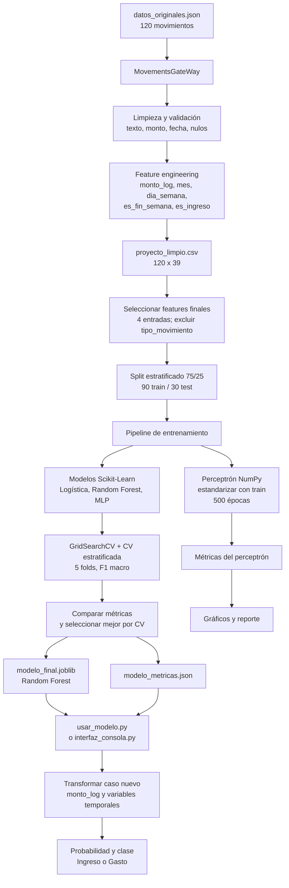
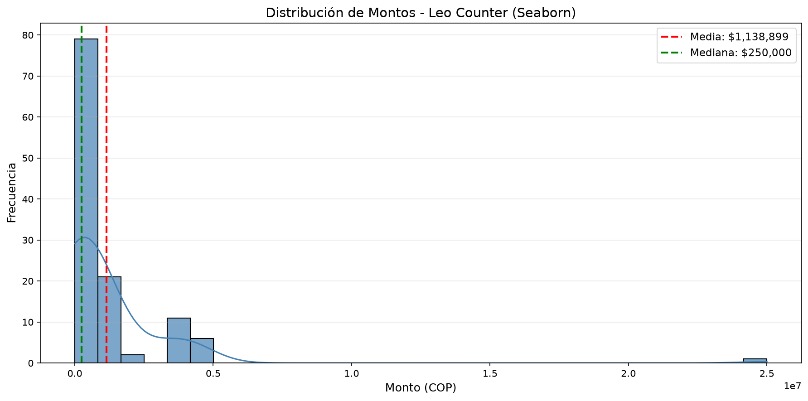
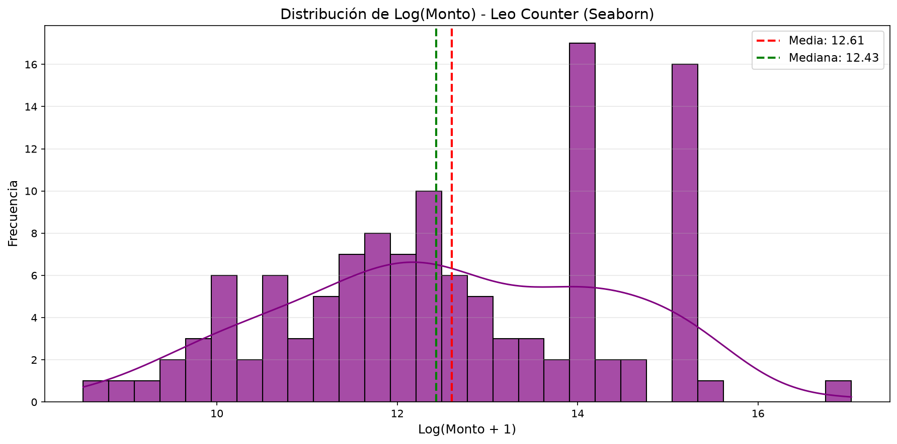
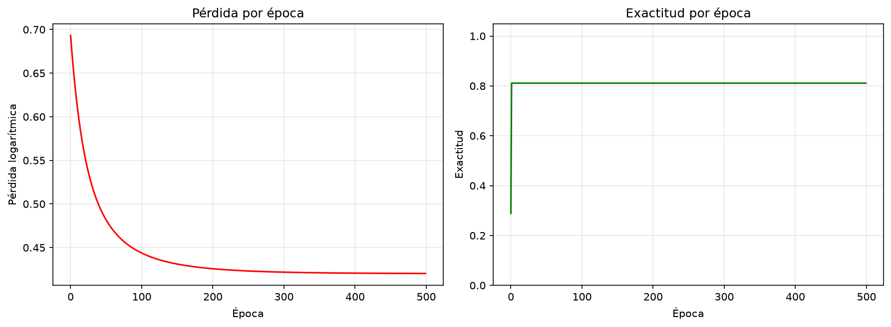
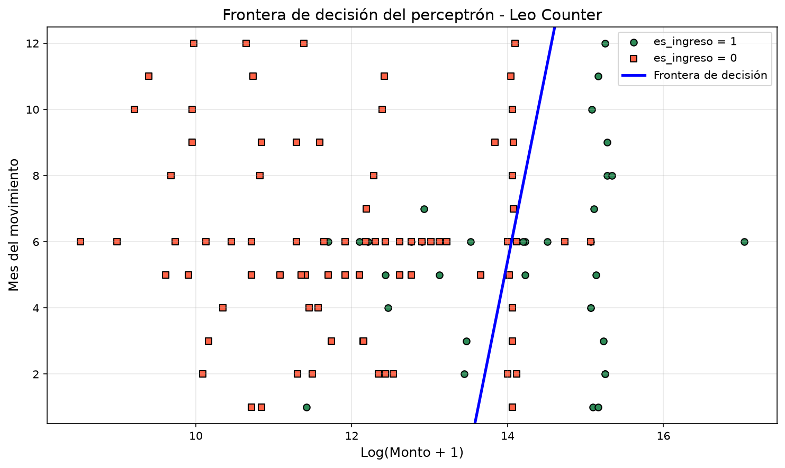
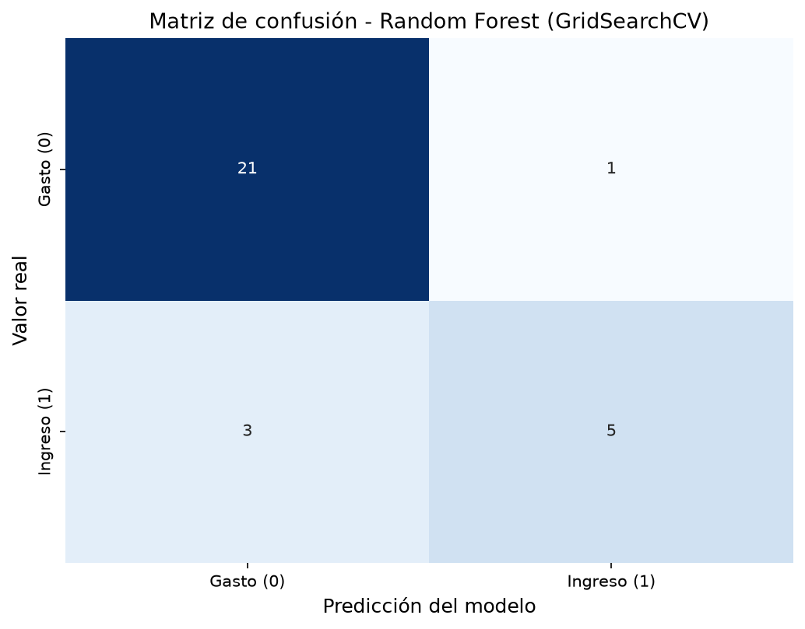
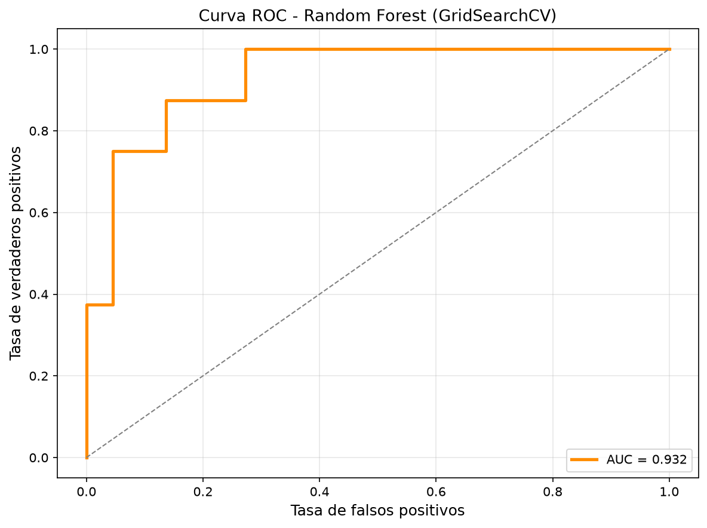
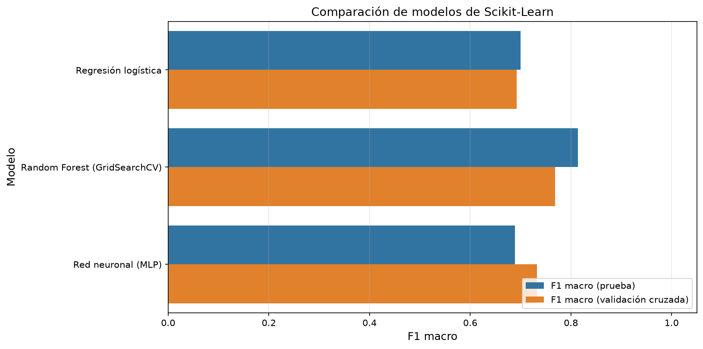
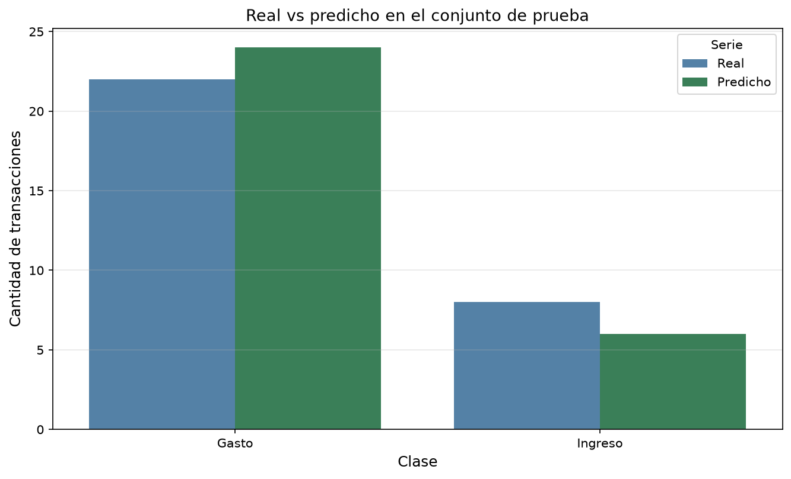

# LEO COUNTER AI: clasificación de movimientos financieros mediante un perceptrón y modelos de Scikit-Learn

**Juan Esteban Villamil Echavarría**  
Ingeniería de Sistemas  
Corporación de Estudios Tecnológicos del Norte del Valle  
Asignatura: Inteligencia Artificial  
Docente: Jhon James Cano Sánchez  
22 de noviembre de 2026

---

# Resumen

Los hogares y pequeñas empresas de Cartago, Valle del Cauca, registran ingresos y gastos en gestores financieros, pero con frecuencia deben revisar y clasificar manualmente cada movimiento. Este proyecto construye un componente de inteligencia artificial para Leo Counter AI capaz de clasificar una transacción como ingreso o gasto a partir de su monto y variables temporales. Se trabajó con 120 movimientos anonimizados y ampliados con datos sintéticos coherentes: 86 gastos y 34 ingresos, registrados entre marzo de 2024 y septiembre de 2026. El proceso incluyó exploración, limpieza, transformación logarítmica del monto, extracción de variables temporales y separación estratificada entre entrenamiento y prueba. Se implementó un perceptrón desde cero con NumPy y se compararon regresión logística, Random Forest y una red neuronal MLP mediante pipelines de Scikit-Learn, validación cruzada estratificada y métricas de clasificación. El mejor modelo fue Random Forest ajustado con GridSearchCV, con F1 macro de validación cruzada de 0.7683 y exactitud de prueba de 0.8667. El modelo se serializó con Joblib y se integró a un script de predicción y a un menú de consola reproducible mediante Docker. Los resultados muestran que el monto transformado es la variable más informativa, aunque el tamaño y el carácter sintético de la muestra limitan la generalización. El sistema constituye un prototipo funcional, no un sustituto de la validación financiera humana.

**Palabras clave:** aprendizaje automático, finanzas personales, clasificación binaria, Random Forest, Cartago.

# Introducción

Las herramientas de finanzas personales permiten registrar movimientos, consultar saldos y observar la evolución del dinero. Sin embargo, el registro por sí solo no garantiza que el usuario obtenga información accionable. Una persona puede tener cientos de transacciones y seguir necesitando clasificar, revisar y comparar manualmente sus movimientos. Esta situación es especialmente relevante para hogares y pequeñas empresas de Cartago, Valle del Cauca, donde un sistema de bajo costo puede facilitar la lectura de la información financiera cotidiana sin exigir conocimientos especializados de análisis de datos.

Leo Counter es el contexto de aplicación de este proyecto. El problema abordado es la clasificación binaria de movimientos financieros en las clases **Ingreso** y **Gasto**, con el propósito de apoyar reportes, filtros y futuras alertas. El sistema no pretende decidir si una operación es correcta ni recomendar productos financieros. Su función es ofrecer una primera predicción interpretable que pueda ser confirmada o corregida por el usuario.

El reto tiene dos características importantes. Primero, el monto presenta una distribución muy asimétrica: la mayoría de movimientos son pequeños, pero existen operaciones de valor alto, como una venta de vehículo. Segundo, las clases están desbalanceadas: 86 registros corresponden a gastos y 34 a ingresos. Por estas razones no resulta suficiente observar únicamente la exactitud. Se utiliza F1 macro para dar importancia a ambas clases y se aplica validación cruzada estratificada para obtener una estimación más estable.

El proyecto responde a la siguiente pregunta: **¿un pipeline reproducible, que combine variables financieras y temporales, un perceptrón implementado desde cero y modelos de Scikit-Learn, puede clasificar movimientos nuevos de Leo Counter con un desempeño útil para apoyar el análisis financiero?** Para responderla se construyó el ciclo completo exigido en la asignatura: datos, preparación, modelo desde cero, comparación de modelos, evaluación, persistencia y demostración.

El informe presenta primero los objetivos y el marco teórico; después describe los datos y la metodología; luego presenta los resultados del análisis exploratorio, del perceptrón y de los modelos de Scikit-Learn; finalmente discute las limitaciones, la ética y el trabajo futuro.

# Objetivos

## Objetivo general

Construir y evaluar un prototipo reproducible de inteligencia artificial para clasificar movimientos financieros de Leo Counter como ingresos o gastos, usando un perceptrón implementado con NumPy y modelos de Scikit-Learn integrados en un pipeline.

## Objetivos específicos

1. Preparar y documentar un conjunto de 120 movimientos financieros mediante limpieza, transformación de variables y generación de un dataset listo para aprendizaje automático.
2. Implementar desde cero un perceptrón con NumPy, incluyendo división entrenamiento-prueba, estandarización aprendida únicamente con entrenamiento, actualización de pesos y evaluación.
3. Comparar regresión logística, Random Forest y MLPClassifier mediante pipelines, validación cruzada estratificada y métricas adecuadas para clases desbalanceadas.
4. Seleccionar, serializar y utilizar el mejor modelo para predecir casos nuevos desde un script y una interfaz de consola reproducibles con Docker.

# Marco teórico

## Aprendizaje automático supervisado

El aprendizaje supervisado construye una función a partir de ejemplos que contienen variables de entrada y una etiqueta conocida. En este proyecto, las entradas son `monto_log`, `mes`, `dia_semana` y `es_fin_semana`, mientras que la etiqueta es `es_ingreso`. El objetivo es aprender una frontera que permita asignar una clase a un movimiento que no haya sido utilizado durante el ajuste. La separación entre datos de entrenamiento y prueba es fundamental porque evaluar con los mismos datos usados para aprender produciría una estimación optimista (Géron, 2022).

## Perceptrón, sigmoide y pérdida

El perceptrón es una unidad de clasificación que combina entradas ponderadas y un sesgo. En una versión probabilística, la combinación lineal se transforma mediante la función sigmoide:

\[
\hat{y}=\sigma(z)=\frac{1}{1+e^{-z}}, \qquad z=w^Tx+b.
\]

La salida se interpreta como probabilidad de la clase positiva. Para entrenarlo se utilizó la pérdida de entropía cruzada binaria, que penaliza predicciones seguras pero incorrectas. El descenso del gradiente calcula cómo cambia la pérdida con respecto a cada peso y actualiza los parámetros en la dirección que la reduce. Rosenblatt (1958) introdujo el perceptrón como un modelo elemental de clasificación; las redes modernas conservan la idea de combinar entradas mediante parámetros aprendibles, aunque usan arquitecturas y funciones más complejas.

En la implementación del proyecto, el escalamiento del perceptrón se ajusta solo con el conjunto de entrenamiento. Esta decisión evita que la media y la desviación estándar del conjunto de prueba influyan indirectamente en el aprendizaje. Los pesos permiten interpretar la dirección de la relación aprendida, pero no deben confundirse con causalidad.

## Regresión logística

La regresión logística estima la probabilidad de una clase mediante una combinación lineal y una función sigmoide. Es un modelo de referencia útil por su sencillez y por permitir interpretar el efecto relativo de las variables bajo sus supuestos. En este trabajo se configuró con `class_weight='balanced'`, de modo que la clase minoritaria no quedara ignorada por el desbalance.

## Random Forest

Random Forest combina múltiples árboles de decisión entrenados con muestras y subconjuntos de variables distintos. La predicción agregada suele ser más estable que la de un árbol individual y puede representar relaciones no lineales entre monto y calendario (Breiman, 2001). En el proyecto se ajustaron hiperparámetros mediante GridSearchCV y se seleccionó una configuración con 200 árboles, profundidad máxima 3 y mínimo de una muestra por hoja.

## Red neuronal MLP

MLPClassifier representa una red neuronal multicapa. Su capacidad para aprender transformaciones no lineales permite compararla con modelos lineales y basados en árboles. Se utilizó una arquitectura con capas ocultas `(16, 8)` y el optimizador `lbfgs`. La red fue incluida como valor agregado, pero su desempeño en esta muestra fue inferior al del bosque aleatorio.

Scikit-Learn ofrece estimadores, validación cruzada y pipelines que permiten encadenar transformaciones y modelos en una única estructura reproducible (Pedregosa et al., 2011). En particular, un pipeline reduce el riesgo de aplicar una transformación usando información que debería permanecer reservada para prueba.

## Métricas de evaluación

La exactitud es la proporción de predicciones correctas. La precisión mide qué proporción de las predicciones positivas fue correcta y el recall mide qué proporción de los positivos reales fue recuperada. El F1 combina precisión y recall mediante su media armónica. Como existen dos clases con tamaños diferentes, se reporta F1 macro, que calcula el F1 de cada clase y luego les asigna el mismo peso.

La matriz de confusión permite observar los errores por clase. El ROC-AUC resume la capacidad de ordenar positivos por encima de negativos a distintos umbrales. Finalmente, la validación cruzada estratificada divide los datos en cinco particiones conservando aproximadamente la proporción de clases. La media y desviación del F1 macro de esas particiones se usan para comparar modelos antes de observar el conjunto de prueba.

# Metodología

## Diseño general

Se desarrolló un prototipo experimental de clasificación binaria con arquitectura por capas. El acceso a los datos está aislado en `MovementsGateWay.py`; las entidades y colecciones representan el dominio; los pipelines organizan pasos atómicos; los servicios contienen cálculos; los controladores conectan los casos de uso; y los renderizadores generan gráficos. Esta separación facilita reemplazar el archivo JSON por una API real de Leo Counter en una etapa posterior.

## Fuente y diccionario de variables

La fuente canónica es `project/data/datos_originales.json`. Contiene datos de ejemplo de Leo Counter, anonimizados y ampliados con movimientos sintéticos coherentes. No contiene información personal real. El período cubierto va del 15 de marzo de 2024 al 25 de septiembre de 2026.

**Tabla 1**  
*Diccionario de variables del archivo original*

| Variable | Tipo | Descripción |
|---|---|---|
| `id` | Texto | UUID v7 único del movimiento. |
| `nombre` | Texto | Nombre corto de la operación. |
| `cuenta` | Texto | Cuenta o medio de pago. |
| `categoria` | Texto | Categoría principal. |
| `tipo_movimiento` | Texto | `Ingreso` o `Gasto`. |
| `monto` | Texto numérico | Valor en pesos colombianos. |
| `fecha` | Fecha ISO | Fecha del movimiento. |
| `descripcion` | Texto | Descripción libre de la operación. |

El archivo contiene 120 filas: 86 gastos (71.7 %) y 34 ingresos (28.3 %). El objetivo `es_ingreso` se deriva de `tipo_movimiento`. Aunque `categoria` y `tipo_movimiento` se codifican para el dataset exploratorio, no se utilizan como entradas del clasificador final. Excluir `tipo_movimiento` es indispensable porque contiene directamente la respuesta; incluirlo produciría fuga de información.

## Preparación y análisis exploratorio

El pipeline de preparación realiza las siguientes operaciones:

1. Carga el JSON mediante la puerta de acceso del dominio.
2. Normaliza espacios en campos textuales y corrige tipos.
3. Convierte `monto` a numérico y `fecha` a fecha.
4. Descarta fechas inválidas, montos no positivos y duplicados; en el dataset final no se eliminó ninguna fila.
5. Revisa nulos e imputa mediana para numéricas y moda para categóricas cuando es necesario; no hubo nulos que imputar.
6. Conserva los valores atípicos porque corresponden a operaciones plausibles y crea `monto_log = log1p(monto)` para reducir su impacto.
7. Deriva `es_ingreso`, `mes`, `dia_semana` y `es_fin_semana`.
8. Genera un CSV persistente en `project/data/proyecto_limpio.csv` y gráficos EDA.

El dataset pasó de 120 × 8 columnas originales a 120 × 39 después del one-hot encoding. Se identificaron 13 categorías y 11 cuentas. El monto presentó skewness de 7.0951 y 18 valores atípicos por IQR (15 %). La transformación logarítmica redujo la asimetría aproximadamente de 7.10 a -0.05. La mediana de los ingresos fue $2.750.000 y la de los gastos $165.000.

## Variables del modelo y control de fuga

El clasificador final usa cuatro entradas:

- `monto_log`: transformación logarítmica del monto en COP.
- `mes`: mes de la fecha, entre 1 y 12.
- `dia_semana`: día de la semana, de lunes 0 a domingo 6.
- `es_fin_semana`: indicador binario para sábado y domingo.

La variable objetivo es `es_ingreso`, con 1 para ingreso y 0 para gasto. No se usan `tipo_movimiento`, `categoria`, `cuenta`, `nombre` ni `descripcion` como predictores finales. La primera contiene la etiqueta y las restantes no fueron incorporadas al alcance de esta versión.

## Perceptrón desde cero

El pipeline de entrenamiento del perceptrón selecciona `monto_log` y `mes`, divide los datos de manera estratificada en 90 registros de entrenamiento y 30 de prueba, calcula media y desviación usando únicamente entrenamiento, y entrena durante 500 épocas con tasa de aprendizaje 0.1. El servicio de NumPy calcula sigmoide, pérdida, gradientes y predicciones sin utilizar un clasificador preconstruido.

El modelo obtenido produjo los siguientes valores reportados por el programa: `w1 = 1.6713`, `w2 = -0.2344` y `b = -1.3967`. La pérdida pasó de 0.4203 a 0.3893 en entrenamiento. La exactitud fue 81.11 % en entrenamiento y 76.67 % en prueba, frente a una línea base de mayoría de 73.33 % en prueba. La diferencia positiva sobre la línea base es una señal inicial de aprendizaje, aunque la muestra es pequeña.

## Modelos de Scikit-Learn

Se construyeron pipelines independientes para regresión logística, Random Forest y MLPClassifier. Cada pipeline mantiene las transformaciones asociadas al modelo y se evalúa con los mismos conjuntos. La comparación usa `StratifiedKFold(n_splits=5)` y `scoring='f1_macro'`. Random Forest se optimiza con GridSearchCV. El criterio de selección del modelo final es la media de F1 macro en validación cruzada, no la métrica del conjunto de prueba.

La división 75/25 se fijó con `random_state=42` para reproducibilidad. El conjunto de prueba solo se utilizó para reportar el comportamiento final. El artefacto seleccionado se guarda como `project/src/modelo_final.joblib` y las métricas se guardan en `project/src/modelo_metricas.json`.

## Entorno reproducible

El proyecto fija sus dependencias en `project/requirements.txt` y define `Dockerfile` y `docker-compose.yml`. Los comandos principales son:

```bash
cd project
docker compose build
docker compose run --rm app python src/data_preparation.py
docker compose run --rm app python src/perceptron_proyecto.py
docker compose run --rm app python src/modelo_proyecto.py
docker compose run --rm app python src/usar_modelo.py
docker compose run --rm -it app python src/interfaz_consola.py
```

La ejecución de `usar_modelo.py` no reentrena el modelo: carga el archivo Joblib, lee sus metadatos y realiza predicciones sobre casos nuevos.

## Diagrama del flujo de entrenamiento y uso

**Figura 1**  
*Flujo completo de preparación, entrenamiento, selección y uso del modelo*



*Nota.* Elaboración propia con base en la arquitectura de `project/src`.

# Resultados

## Exploración de los datos

**Tabla 2**  
*Resumen descriptivo de los movimientos*

| Indicador | Ingresos | Gastos | Total |
|---|---:|---:|---:|
| Registros | 34 | 86 | 120 |
| Suma | $99.006.100 | $37.661.800 | $136.667.900 |
| Media | $2.911.944 | $437.928 | $1.138.899 |
| Mediana | $2.750.000 | $165.000 | $250.000 |
| Desviación estándar | $4.252.897 | $615.382 | $2.557.255 |
| Mínimo | $91.000 | $5.000 | $5.000 |
| Máximo | $25.000.000 | $3.500.000 | $25.000.000 |

La diferencia entre media y mediana confirma la influencia de valores extremos. El registro máximo de $25.000.000 corresponde a una operación puntual y no se eliminó como error. El análisis de correlación encontró relación entre `es_ingreso` y `monto_log` de 0.551, mientras que `es_fin_semana` y `monto` presentaron una relación cercana a cero (0.009). Esto anticipa que el monto será más útil que la condición de fin de semana.

**Figura 2**  
*Distribución de montos antes de la transformación*



*Nota.* Elaboración propia con Seaborn. La distribución presenta una cola derecha y valores altos aislados.

**Figura 3**  
*Distribución del monto después de la transformación logarítmica*



*Nota.* Elaboración propia con Seaborn.

## Evaluación del perceptrón

**Tabla 3**  
*Resultados del perceptrón implementado con NumPy*

| Indicador | Resultado |
|---|---:|
| Entrenamiento | 90 registros |
| Prueba | 30 registros |
| Variables | `monto_log`, `mes` |
| Épocas | 500 |
| Tasa de aprendizaje | 0.1 |
| Pesos finales | `w1=1.6713`, `w2=-0.2344` |
| Sesgo | `b=-1.3967` |
| Pérdida inicial | 0.4203 |
| Pérdida final de entrenamiento | 0.3893 |
| Exactitud de entrenamiento | 81.11 % |
| Exactitud de prueba | 76.67 % |
| Línea base en prueba | 73.33 % |

El peso positivo de `monto_log` indica que, manteniendo las demás condiciones, los montos más altos favorecen la clase ingreso. El peso negativo de `mes` representa la relación aprendida en esta muestra específica y no debe interpretarse como una regla financiera general. La diferencia entre entrenamiento y prueba es moderada, pero debe observarse con cautela por el bajo número de registros.

**Figura 4**  
*Curva de aprendizaje del perceptrón*



*Nota.* Elaboración propia con NumPy y Matplotlib.

**Figura 5**  
*Frontera de decisión del perceptrón*



*Nota.* Elaboración propia con NumPy y Matplotlib.

## Comparación de modelos

**Tabla 4**  
*Comparación de modelos en el conjunto de prueba y validación cruzada*

| Modelo | Exactitud | Precisión | Recall | F1 macro | F1 ingreso | ROC-AUC | CV F1 macro |
|---|---:|---:|---:|---:|---:|---:|---:|
| Regresión logística | 0.7333 | 0.5000 | 0.7500 | 0.7000 | 0.6000 | 0.8693 | 0.6924 |
| **Random Forest (GridSearchCV)** | **0.8667** | **0.8333** | 0.6250 | **0.8137** | **0.7143** | **0.9318** | **0.7683** |
| MLP `(16,8)` | 0.7667 | 0.5714 | 0.5000 | 0.6889 | 0.5333 | 0.7614 | 0.7330 |

Random Forest fue seleccionado por presentar el mayor F1 macro de validación cruzada (0.7683). Su exactitud de prueba fue 0.8667 y su ROC-AUC 0.9318. El conjunto de prueba contiene 21 gastos correctamente identificados, un gasto clasificado como ingreso, tres ingresos clasificados como gasto y cinco ingresos correctamente identificados. La matriz de confusión es, por tanto, `[[21, 1], [3, 5]]` cuando las filas representan la clase real gasto/ingreso y las columnas la clase predicha.

**Figura 6**  
*Matriz de confusión del Random Forest seleccionado*



*Nota.* Elaboración propia con Scikit-Learn.

**Figura 7**  
*Curva ROC de los modelos comparados*



*Nota.* Elaboración propia con Scikit-Learn.

**Figura 8**  
*Comparación de métricas entre los modelos*



*Nota.* Elaboración propia con Scikit-Learn.

**Figura 9**  
*Valores reales frente a valores predichos*



*Nota.* Elaboración propia con Scikit-Learn.

## Predicciones de casos nuevos

El script `usar_modelo.py` cargó el Random Forest sin volver a entrenarlo y evaluó cuatro casos. La entrada de uso contiene monto, mes y día de la semana; `monto_log` y `es_fin_semana` se calculan internamente.

**Tabla 5**  
*Predicciones producidas por el modelo serializado*

| Monto | Mes | Día de semana | Probabilidad de ingreso | Clase |
|---:|---:|---:|---:|---|
| $85.000 | 6 | 2 | 12.97 % | Gasto |
| $3.500.000 | 4 | 1 | 91.14 % | Ingreso |
| $250.000 | 11 | 6 | 31.76 % | Gasto |
| $45.000 | 12 | 5 | 13.25 % | Gasto |

Las predicciones son coherentes con el patrón general observado: el caso de $3.500.000 recibe alta probabilidad de ingreso y los montos pequeños son clasificados como gasto. La probabilidad no es una certeza ni una recomendación; representa la salida del modelo bajo la distribución de datos usada durante el entrenamiento.

# Discusión

El resultado principal indica que un modelo de árboles ensamblados puede capturar mejor que los modelos lineales y la MLP la relación entre el tamaño del movimiento y su clase. La exactitud de 86.67 % es favorable para un prototipo, pero el valor más relevante es el F1 macro de 0.8137 en prueba y 0.7683 en validación cruzada. La diferencia entre ambas cifras recuerda que una sola partición puede ser optimista. El recall de ingresos fue 0.625: el sistema todavía deja pasar tres de ocho ingresos del conjunto de prueba como gastos.

En el contexto de Cartago, una clasificación automática puede ayudar a organizar reportes y reducir trabajo repetitivo. Por ejemplo, el sistema podría sugerir una clase al registrar una transacción y permitir que el usuario la confirme. No debería bloquear movimientos, modificar saldos ni generar decisiones crediticias. La interfaz de consola demuestra el flujo técnico, pero una integración real requeriría autenticación, trazabilidad, mensajes claros y una forma sencilla de corregir predicciones.

La primera limitación es el tamaño de la muestra. Con 120 registros, cinco particiones de validación cruzada producen subconjuntos pequeños y las métricas pueden cambiar considerablemente al incorporar nuevos datos. La segunda es la composición de la fuente: aunque los movimientos son coherentes y anonimizados, parte de la ampliación es sintética. El comportamiento aprendido puede no representar a todas las familias o empresas de Cartago. La tercera es la limitación de variables. El modelo no usa descripción, categoría ni cuenta, por lo que no puede aprender información semántica ni diferencias particulares entre usuarios.

Existe además un posible sesgo temporal y de selección. Los datos cubren determinados años, cuentas y tipos de operación; si se reciben movimientos de otra región, moneda, inflación o patrón laboral, el desempeño puede deteriorarse. El modelo tampoco se ha evaluado con un conjunto externo ni con datos en producción. La probabilidad entregada debe calibrarse antes de mostrarse como una confianza al usuario.

Desde la perspectiva ética, la información financiera es sensible. Una implementación real debe minimizar datos, anonimizar identificadores, controlar el acceso, cifrar almacenamiento y registrar quién consulta o modifica predicciones. Los usuarios deben saber que el resultado es una sugerencia automática y poder corregirlo. No se deben usar estas predicciones para negar servicios financieros ni para inferir atributos personales. También es necesario monitorear errores por usuario y clase, porque una alta exactitud global podría ocultar fallas sistemáticas sobre ingresos poco frecuentes.

El pipeline reduce una fuente común de error: excluye `tipo_movimiento` de las variables de entrada y separa entrenamiento de prueba. Además, la selección se hace por validación cruzada, no por escoger retrospectivamente el modelo con mejor resultado en el test. Aun así, la validación de este prototipo no sustituye un estudio longitudinal con datos reales, consentimiento y evaluación de impacto.

# Conclusiones y trabajo futuro

## Conclusiones

1. Se construyó un ciclo completo y reproducible para clasificar movimientos de Leo Counter: carga, limpieza, ingeniería de variables, entrenamiento, evaluación, persistencia y predicción.
2. El análisis exploratorio mostró una fuerte asimetría de los montos y un desbalance entre gastos e ingresos. La transformación `monto_log` fue una decisión adecuada para reducir la influencia de valores extremos.
3. El perceptrón desde cero superó la línea base de mayoría en la prueba, con 76.67 % de exactitud frente a 73.33 %. Esto permitió demostrar el mecanismo interno de actualización de pesos, además de usar una solución de biblioteca.
4. Random Forest fue el mejor de los tres modelos comparados: obtuvo F1 macro de prueba 0.8137, ROC-AUC 0.9318 y CV F1 macro 0.7683. Por ello se serializó como `modelo_final.joblib`.
5. `usar_modelo.py` y `interfaz_consola.py` permiten utilizar el modelo sin reentrenamiento, y Docker hace explícito el entorno de ejecución.
6. El prototipo es útil como asistencia para organizar transacciones, pero sus resultados no deben interpretarse como certeza ni como asesoría financiera debido al tamaño, origen y carácter parcialmente sintético de los datos.

## Trabajo futuro

- Recolectar más datos reales, con consentimiento, anonimización y diversidad de hogares y pequeñas empresas de Cartago.
- Incorporar texto de `descripcion` mediante TF-IDF o embeddings para clasificar subcategorías, sin incluir la etiqueta como predictor.
- Evaluar por usuario y por período temporal, además de usar un conjunto externo y una prueba posterior en el tiempo.
- Calibrar probabilidades, monitorear deriva de datos y establecer umbrales distintos según el costo de cada error.
- Crear una interfaz web integrada a Leo Counter con confirmación humana, explicación de variables y registro de correcciones.
- Comparar modelos con aprendizaje incremental y reentrenamiento controlado, manteniendo versiones de datos y artefactos.
- Añadir pruebas automatizadas, validación de esquemas y controles de privacidad para una eventual puesta en producción.

# Referencias

Breiman, L. (2001). Random forests. *Machine Learning, 45*(1), 5–32. https://doi.org/10.1023/A:1010933404324

Géron, A. (2022). *Hands-on machine learning with Scikit-Learn, Keras, and TensorFlow* (3rd ed.). O’Reilly Media.

Goodfellow, I., Bengio, Y., & Courville, A. (2016). *Deep learning*. MIT Press. https://www.deeplearningbook.org/

Minsky, M., & Papert, S. (1969). *Perceptrons: An introduction to computational geometry*. MIT Press.

Pedregosa, F., Varoquaux, G., Gramfort, A., Michel, V., Thirion, B., Grisel, O., Blondel, M., Prettenhofer, P., Weiss, R., Dubourg, V., Vanderplas, J., Passos, A., Cournapeau, D., Brucher, M., Perrot, M., & Duchesnay, É. (2011). Scikit-learn: Machine learning in Python. *Journal of Machine Learning Research, 12*, 2825–2830. https://jmlr.org/papers/v12/pedregosa11a.html

Python Software Foundation. (2024). *Python* (Versión 3.12) [Software]. https://www.python.org/

Rosenblatt, F. (1958). The perceptron: A probabilistic model for information storage and organization in the brain. *Psychological Review, 65*(6), 386–408. https://doi.org/10.1037/h0042519

Scikit-learn developers. (2026). *Scikit-learn: Machine learning in Python* (versión 1.9.1) [Software]. https://scikit-learn.org/

# Apéndices

## Apéndice A. Enlace al repositorio y estructura

Repositorio: [https://github.com/juanVillamilEchavarria/Inteligencia_artificial_U](https://github.com/juanVillamilEchavarria/Inteligencia_artificial_U)

Archivos principales:

- `project/data/datos_originales.json`: fuente de 120 movimientos.
- `project/src/data_preparation.py`: preparación y EDA.
- `project/src/perceptron_proyecto.py`: perceptrón NumPy.
- `project/src/modelo_proyecto.py`: comparación de modelos y persistencia.
- `project/src/usar_modelo.py`: carga y predicción.
- `project/src/interfaz_consola.py`: menú interactivo.
- `project/src/modelo_final.joblib`: modelo seleccionado.
- `project/src/modelo_metricas.json`: métricas y parámetros.
- `project/Dockerfile`, `project/docker-compose.yml`, `project/requirements.txt`: reproducibilidad.

## Apéndice B. Fragmentos de código relevantes

### Selección de variables sin fuga de información

```python
feature_names = (
    "monto_log",
    "mes",
    "dia_semana",
    "es_fin_semana",
)
target_name = "es_ingreso"
```

La variable `tipo_movimiento`, que define el objetivo, no se envía al modelo. La información de categoría y cuenta tampoco se usa como entrada del clasificador final.

### División y validación

```python
X_train, X_test, y_train, y_test = train_test_split(
    X, y, test_size=0.25, stratify=y, random_state=42
)
cv = StratifiedKFold(n_splits=5, shuffle=True, random_state=42)
```

### Uso del modelo persistido

```python
payload = controller.loadModel()
predictions = controller.predictNewCases(newCases)
```

`usar_modelo.py` carga `modelo_final.joblib` y `modelo_metricas.json`; después transforma cada caso nuevo y muestra probabilidad y clase, sin ejecutar nuevamente el entrenamiento.

## Apéndice C. Declaración de uso de inteligencia artificial

Durante la elaboración de este informe se utilizó **OpenAI ChatGPT**, mediante el entorno de asistencia de programación OpenCode, como apoyo para organizar la estructura del documento, mejorar la redacción, revisar la coherencia entre los lineamientos y los apartados, y proponer la presentación del diagrama de flujo. La herramienta no sustituyó la ejecución del proyecto ni la interpretación técnica de sus resultados.

Las cifras del informe fueron verificadas contra `project/src/modelo_metricas.json`, `project/src/eda_summary.md`, `README.md` y las salidas de los scripts. La estructura, nombres de archivos, métricas, predicciones y decisiones metodológicas fueron contrastadas con el código del repositorio. El autor es responsable de revisar, explicar y sustentar todo el contenido entregado, así como de corregir cualquier error detectado antes de convertir este documento a PDF.

La herramienta se referencia de acuerdo con el lineamiento de la asignatura: OpenAI. (2026). *ChatGPT* [Modelo de lenguaje de gran tamaño]. https://chat.openai.com/
